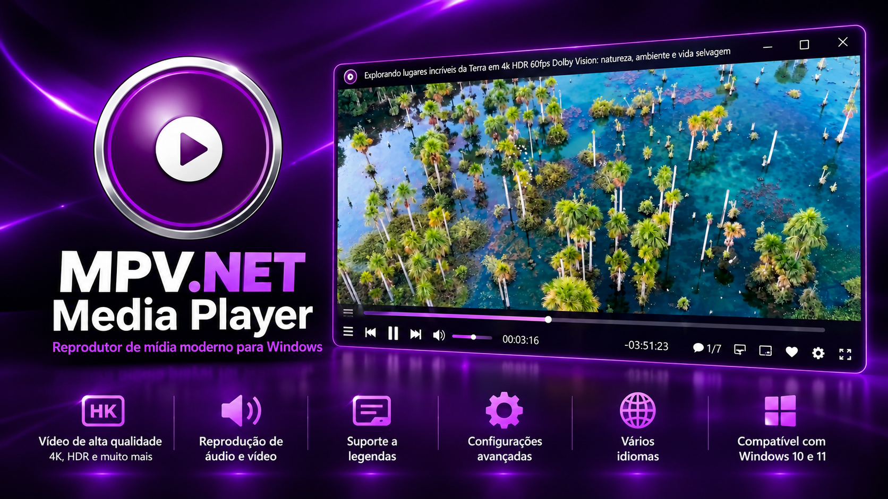
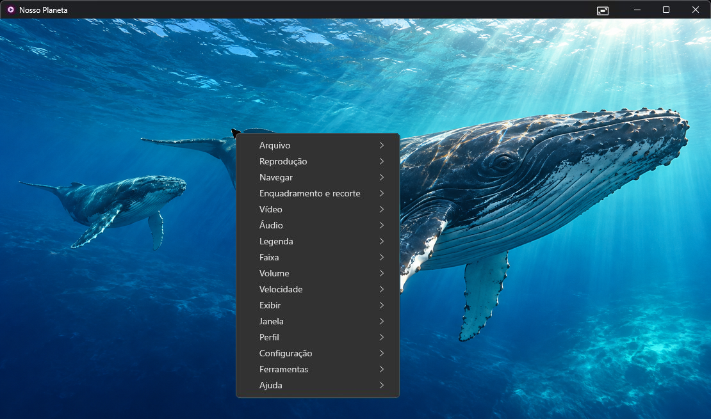
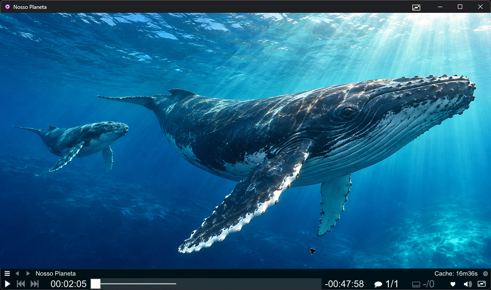

# MPV.NET Media Player

Player de mídia para Windows baseado no mpv.net e no mpv/libmpv, com suporte às opções, aos comandos e aos arquivos de configuração do mpv.

## Download

Baixe o instalador ou o ZIP portátil nas [releases do GitHub](https://github.com/WandersondeSouza/mpv.net/releases). O player também está na [Microsoft Store](https://apps.microsoft.com/detail/9N441SP6XHLD).

Requer Windows x64, a partir do Windows 10 versão 2004 (build 19041).

## Uso rápido

- Arraste um vídeo, áudio ou playlist para a janela. Use `Ctrl+v` para
  abrir um caminho ou URL copiado.
- Pressione `Ctrl+,` para abrir o
  [editor de configuração](docs/manual.md#configuração).
- Veja os [controles de reprodução](docs/manual.md#controles-de-reprodução).

Com `mpvnet.exe` disponível no `PATH`, você também pode abrir mídia
pelo PowerShell.

```powershell
mpvnet.exe "C:\Videos\filme.mp4"
mpvnet.exe "C:\Listas\iptv.m3u"
mpvnet.exe "https://example.com/live/index.m3u8"
```

## Documentação principal

- [Manual](docs/manual.md)
- [Integração por parâmetros: vídeo, título e 20 idiomas](docs/manual.md#integração-por-parâmetros-vídeo-título-e-idioma)
- [Configuração rápida](docs/CONFIGURACAO.md)
- [Atalhos](docs/ATALHOS.md)
- [Logs de diagnóstico](docs/logging.md)

### Desenvolvimento

- [Guia operacional](docs/guia-operacional.md)
- [Arquitetura técnica](docs/developer/architecture.md)
- [Configuração técnica](docs/developer/configuration.md)
- [Integração com mpv/libmpv](docs/developer/mpv-integration.md)
- [Interface Windows](docs/developer/windows-ui.md)
- [Build e release](docs/developer/build-release.md)
- [Localização](docs/developer/localization.md)
- [Artefatos de IA](.ai/README.md)
- [Política de segurança](SECURITY.md)

## Compatibilidade de CPU do libmpv

O player inclui `libmpv-2.dll` e `libmpv-2-v3.dll` nos pacotes x64.
Ele tenta a v3 em CPUs compatíveis e usa a variante normal como fallback.
Consulte a [seleção de libmpv e o diagnóstico](docs/developer/mpv-integration.md#carregamento-dual-de-libmpv).

## Apresentação do player







## Apoie o MPV.NET Media Player

Sua contribuição voluntária ajuda a manter e melhorar o MPV.NET. A contribuição
é opcional e única, não libera funcionalidades nem cria licença ou assinatura.
O MPV.NET continua gratuito.

Acesse a [página oficial de apoio](https://www.gestaodesistemas.com.br/mpvnet).
